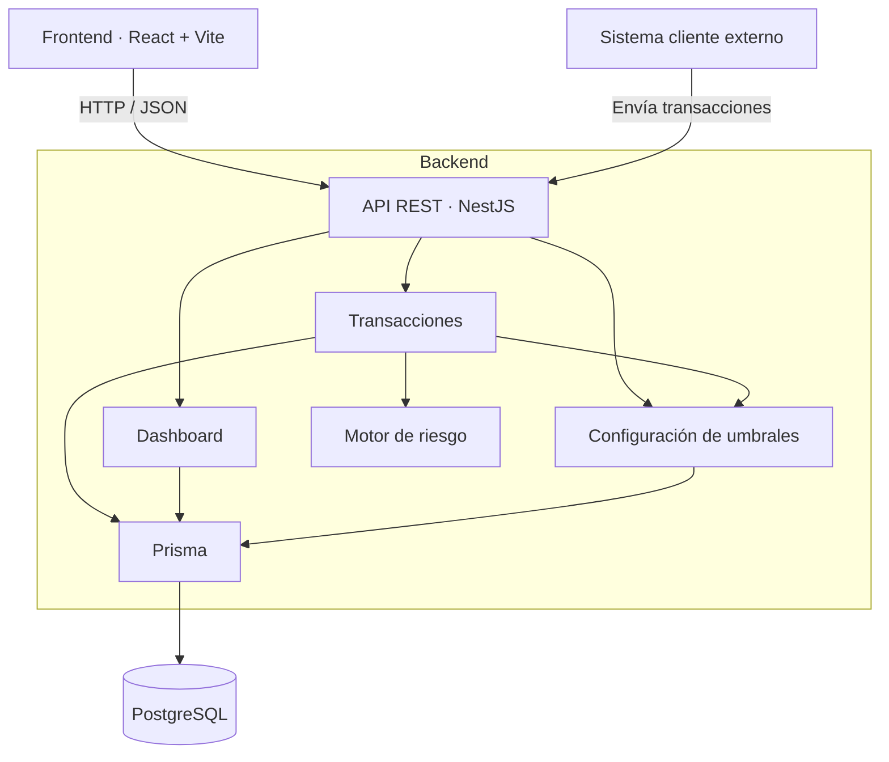

# FraudLens-prototipo

Listo. Creé y levanté correctamente:
- Frontend Vite servido por Nginx: http://localhost:5173
- Backend NestJS: http://localhost:3000/api/v1
- PostgreSQL Docker: localhost:5433
- Comunicación interna backend → PostgreSQL: postgres:5432
- Proxy frontend → backend mediante /api/v1
Los tres contenedores están activos y saludables. También verifiqué el endpoint de salud tanto directo como a través del frontend.
Archivos principales:
- [compose.yaml](/Users/franciscoguerrero/VsCodeProjects/FraudLens-prototipo/Backend/compose.yaml)
- [Dockerfile backend](/Users/franciscoguerrero/VsCodeProjects/FraudLens-prototipo/Backend/Dockerfile)
- [Dockerfile frontend](/Users/franciscoguerrero/VsCodeProjects/FraudLens-prototipo/Frontend/Dockerfile)
- [nginx.conf](/Users/franciscoguerrero/VsCodeProjects/FraudLens-prototipo/Frontend/nginx.conf)
PostgreSQL usa 5433 en el host porque ya existe otro contenedor llamado fraudlens-postgres ocupando 5432.
Comandos útiles:
cd /Users/franciscoguerrero/VsCodeProjects/FraudLens-prototipo/Backend

docker compose up --build -d
docker compose ps
docker compose logs -f
docker compose exec backend npm run seed
docker compose down
El último comando de seed es opcional y carga los datos de demostración.

Edited 8 files+172-1Review changesUndoReview

.dockerignore.dockerignore+8-0
DockerfileDockerfile+34-0
README.mdREADME.md+25-0
compose.yamlcompose.yaml+58-0
package.jsonpackage.json+1-1
Frontend/.dockerignoreFrontend/.dockerignore+6-0
Frontend/DockerfileFrontend/Dockerfile+20-0
Frontend/nginx.confFrontend/nginx.conf+20-0
Collapse files

